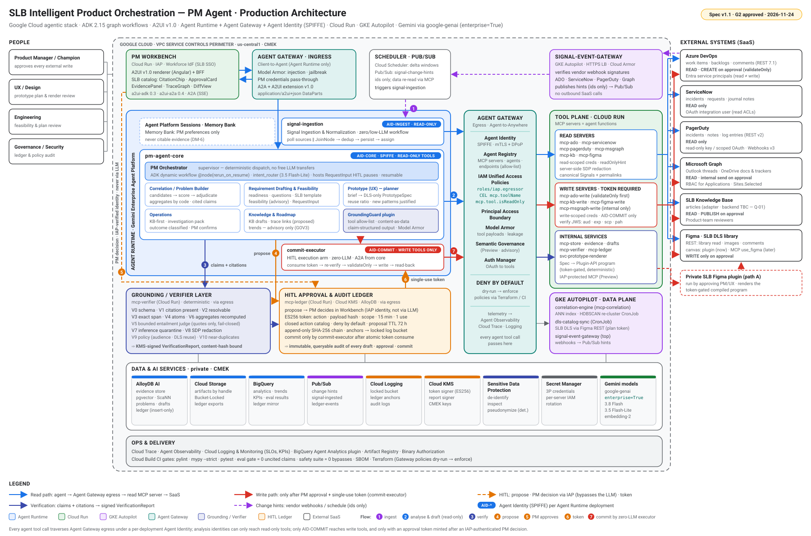

# SLB Intelligent Product Orchestration — PM Agent

A production-grade, multi-agent **"human middleware"** for SLB Product Managers. It continuously ingests and correlates signals from **Azure DevOps, ServiceNow, PagerDuty, Outlook and OneDrive**, builds consolidated **Product Problems**, finds missing information and drafts clarifying questions, writes **cited** requirement drafts in SLB templates, plans **DLS-aligned Figma prototypes**, and turns approved resolutions into **knowledge articles** and **roadmap traceability**. The PM stays in control of every decision and approval.

> **Status — G2 approved (2026-11-24); G3 in progress: reference implementation.**
> This repository is a **reference architecture**: the specification (`docs/`), a runnable, fully tested Python implementation (`src/`), infrastructure as code (`infra/`, `deploy/`) and an evaluation harness (`evals/`). SLB-specific details that are not known yet are carried as tracked placeholders — see [PLACEHOLDERS.md](PLACEHOLDERS.md).
> Stack: **ADK 2.15** (graph workflows) · **A2UI v1.0** · **Agent Runtime** (Gemini Enterprise Agent Platform) · **Agent Gateway** + **Agent Identity** (SPIFFE) · **Cloud Run** · **GKE** · **Gemini** via `google-genai` (`enterprise=True`).



<sub>Vector source: [`docs/diagrams/pm-agent-architecture.svg`](docs/diagrams/pm-agent-architecture.svg) · raster for slides: [`pm-agent-architecture.png`](docs/diagrams/pm-agent-architecture.png) (2400 × 1587)</sub>

---

## Hard constraints and how they're enforced

| Constraint | Mechanism | Code |
|---|---|---|
| **No autonomous writes** (R2) | LLM nodes hold no tools (GroundingGuard denies and ledgers any attempt). Writes run only in the zero-LLM `commit_executor`, with a single-use, payload-bound ES256 approval token minted by the ledger after an authenticated PM decision that never passes through an LLM. Write servers verify the token again. | [`hitl/`](src/pm_agent/hitl), [`executor_app/`](src/pm_agent/executor_app), [`write_server.py`](src/pm_agent/mcp_servers/write_server.py) |
| **No hallucination** (R6) | LLMs emit `evidence_id` + verbatim quote only; the deterministic Verifier resolves spans and runs V0–V10 (exact span, atoms, recomputed aggregates, bounded entailment judge, fail-closed). Blocked claims are removed, never repaired. CI fails on a single uncited claim. | [`verifier.py`](src/pm_agent/grounding/verifier.py) |
| **Secrets & PII redacted automatically** | Connectors normalize through one path (`make_signal`) that redacts before storage; V8 re-inspects every payload before it leaves. | [`connectors/base.py`](src/pm_agent/connectors/base.py), [`redaction.py`](src/pm_agent/grounding/redaction.py) |
| **Every tool call authorized** through Agent Gateway with a down-scoped SPIFFE identity | Three Agent Runtime identities, per-tool IAP egress policies (dry-run first), truthful MCP annotations contract-tested against the registry. | [`infra/`](infra/README.md), [`tests/contract`](tests/contract) |
| **Immutable, queryable audit** | Hash-chained, append-only ledger (the SQLite reference store enforces append-only with triggers; AlloyDB in production), anchored by a CronJob; the control query "commit without consumed token" must be empty. | [`ledger.py`](src/pm_agent/hitl/ledger.py), [`ledger_anchor.py`](src/pm_agent/jobs/ledger_anchor.py) |

## What runs today (offline, no credentials)

| Capability | Workflow | Proven by |
|---|---|---|
| Ingest 5 sources → redact → dedup → correlate into Product Problems | `signal_ingestion` (W1 + W2) | [`test_ingestion_app.py`](tests/component/test_ingestion_app.py) |
| Readiness checklist → clarifying questions → PM answers become evidence → cited requirement draft → V0–V10 → proposal → PM approval → commit | `define_requirement` (W3) | [`test_define_requirement.py`](tests/component/test_define_requirement.py) (CI gate 5 *groundedness*) |
| DLS-only prototype spec → two-person approval (PM + UX) → Figma Plugin-API program | `design_prototype` (W4) | [`test_capabilities.py`](tests/component/test_capabilities.py) |
| Knowledge article → KB reviewer approval → publish; evidence trace; investigation pack; trends | W5–W7 | [`test_capabilities.py`](tests/component/test_capabilities.py) |
| Decision path browser → BFF → ledger → resume (never via an LLM) | `pm-workbench` BFF | [`test_workbench.py`](tests/component/test_workbench.py) |
| Forged / replayed / expired / mismatched tokens, self-approval, missing quorum, tampered drafts | HITL safety suite | [`test_hitl_safety.py`](tests/unit/test_hitl_safety.py) (CI gate 6) |

## DONE criteria — status

| DONE criterion | Status | Evidence / what is still needed |
|---|---|---|
| Signals from ADO, ServiceNow, PagerDuty, Email, OneDrive ingested, normalized, de-duplicated into a Product Problem | ✅ offline | W1/W2 on the synthetic golden set: pairwise precision 1.00, recall 0.96 (`make evals`); live connectors need Q-04/05/07/13 |
| Missing information identified, clarifying questions drafted | ✅ offline | readiness checklist → verified questions → PM answers become `pm_input` evidence |
| Requirement draft in the SLB template, every populated field cited | ✅ offline | CI gate 5 *groundedness*: 0 uncited claims; template fields are config (Q-04) |
| Prototype in Figma reusing SLB DLS components | 🟡 up to the compiled program | DLS-only spec (V9), PM + UX approval, Plugin-API program; rendering needs the private plugin (Q-02) and the real DLS library (Q-03) |
| No writes without explicit PM approval | ✅ | safety suite (CI gate 6), mutation-checked |
| Immutable, queryable audit ledger | ✅ reference store | hash chain + append-only store + anchor job; AlloyDB store in the dev project (Q-10) |
| Groundedness evals gate CI at zero uncited claims | ✅ | `cloudbuild.yaml` gate 5 + `evals/run_offline.py` hard gate |
| Every tool call authorized through Agent Gateway with a down-scoped SPIFFE identity | 🟡 IaC ready | Terraform: Agent Identity, Registry, per-tool IAP egress policies (dry-run); enforcement needs a deployment (Q-10) |
| Deployed on Cloud Run and GKE | 🟡 IaC ready | `infra/terraform` (dev/stage/prod), `deploy/Dockerfile`, `deploy/k8s`; not deployed — needs the GCP org/projects (Q-10) and ADC |

## Specification map

| # | Document | What it settles |
|---|---|---|
| 00 | [Methodology & phase gates](docs/00-methodology-and-phase-gates.md) | AI Black Belt lifecycle P0–P6, gate criteria, current status, releases R1–R5 |
| 01 | [Requirements traceability](docs/01-requirements-traceability.md) | R1–R6, DONE, FR/GOV/NFR/IR → design → verification |
| 02 | [Platform verification log](docs/02-platform-verification-log.md) | What was verified against official docs and installed packages; what is **UNCONFIRMED** |
| 03 | [System architecture](docs/03-system-architecture.md) | Planes, containers, runtime placement, flows, isolation layers, perimeter |
| 04 | [Agent roster](docs/04-agent-roster.md) | The 9 components, why each exists, contracts, rejected alternatives |
| 05 | [Orchestration & workflows](docs/05-orchestration-and-workflows.md) | ADK 2.x supervisor + workflows W1–W7, HITL pauses, verified ADK behaviours |
| 06 | [Grounding / Verifier layer](docs/06-grounding-verifier-layer.md) | Evidence & policy gate: citations, dedup, redaction, policies |
| 07 | [HITL approval & audit ledger](docs/07-hitl-approval-and-audit-ledger.md) | Action catalog, approval protocol, tokens, executor, ledger |
| 08 | [Security, identity & governance](docs/08-security-identity-and-governance.md) | Agent Identity, Agent Gateway policies, down-scoping, threat model |
| 09 | [Connectors & integrations](docs/09-connectors-and-integrations.md) | ADO, ServiceNow, PagerDuty, Graph, Figma, KB adapter, google-genai |
| 10 | [Data model & storage](docs/10-data-model-and-storage.md) | Claim/Citation contract, entities, SLB templates, storage mapping |
| 11 | [A2UI PM Workbench](docs/11-a2ui-pm-workbench.md) | Surfaces, SLB catalog, transport, decision handling |
| 12 | [Deployment & operations](docs/12-deployment-and-operations.md) | Environments, Terraform, CI/CD gates, observability, SLOs, DR |
| 13 | [Testing & evaluation](docs/13-testing-and-evaluation.md) | TDD strategy, golden scenarios, eval suites E1–E8 |
| 14 | [Implementation roadmap](docs/14-implementation-roadmap.md) | Milestones M0–M7, repo layout, pins, spikes |
| 15 | [Risks, assumptions, open questions](docs/15-risks-assumptions-open-questions.md) | Q-01…Q-15 for SLB, risk register |
| 16 | [Architecture decision records](docs/16-architecture-decision-records.md) | ADR-001…ADR-010 (accepted) |

## Approved decisions (G2, 2026-11-24)

1. **Figma rendering** — a private SLB Figma plugin executes a program compiled from the approved, verified `PrototypeSpec` (ADR-006); switch to Figma MCP `use_figma` once admitted to the MCP Catalog.
2. **Runtime placement** — agents on Agent Runtime, MCP tool servers on Cloud Run, data-plane containers on GKE (ADR-002).
3. **SLB Knowledge Base** — backend-agnostic adapter until the backend is confirmed (Q-01).
4. **Two-person rule** — prototype render needs PM **and** UX approval (`require_each_group`); configurable per action in [`pm_agent.yaml`](config/pm_agent.yaml).
5. **Residency** — `us-central1` only by default; non-regional endpoints stay off until Q-09 is answered.
6. **A2UI v1.0** (ADR-007, revised) with exact SDK pins.

## Verified platform baseline (2026-11-24)

| Component | Version | Note |
|---|---|---|
| `google-adk` | 2.15.0 | requires `google-genai >=2.34,<3` |
| `google-genai` | 2.34.0 | `genai.Client(enterprise=True, project=…, location=…)` |
| A2UI | v1.0 (GA 2026-11-11) | `a2ui-agent-sdk` 0.12.1 · `a2ui-adk` 0.3.0 · `a2ui-a2a` 0.4.0 |
| `a2a-sdk` / `mcp` | 0.3.26 / 2.3 | `a2ui-a2a` requires `a2a-sdk <0.4`; MCP `FastMCP` is now `MCPServer` |
| Models | `gemini-3.8-flash`, `gemini-3.5-flash-lite`, `gemini-embedding-2` | pinned ids (ADR-008) |

## Repository layout

```text
SLB/
├── README.md · PLACEHOLDERS.md        ← you are here · every SLB-specific unknown (generated)
├── docs/                              ← specification 00–16 + diagrams/
├── config/                            ← pm_agent.yaml (runtime config with placeholders), DLS sample catalog
├── src/pm_agent/
│   ├── schemas/                       ← entities from docs/10 (Signal, Claim/Citation, drafts, HITL)
│   ├── grounding/                     ← Verifier V0–V10, atoms, judges, redaction, dedup, policy, GroundingGuard
│   ├── hitl/                          ← action catalog, tokens, ledger, identity, approvals, executor, resume
│   ├── agents/                        ← LLM node schemas, instructions, factory, offline models
│   ├── workflows/                     ← W2 problem builder, W3 requirement, W4 prototype, K, operations, HITL tail
│   ├── core_app/ ingestion_app/ executor_app/   ← the three ADK Apps (Agent Runtime)
│   ├── correlation/                   ← problem store, link scoring, aggregates (V6)
│   ├── connectors/ mcp_servers/       ← source connectors, MCP read/write servers
│   ├── a2ui/                          ← A2UI v1.0 surfaces + SLB catalog
│   ├── workbench/ renderer/ event_gateway/ jobs/   ← BFF, Figma renderer, webhook gateway, CronJobs
│   └── runtime.py · serve.py          ← composition root · container dispatcher
├── tests/                             ← unit/ contract/ component/ (no network, no LLM)
├── evals/                             ← E1–E8 suites, S1–S7 stubs, offline baseline
├── infra/terraform/ · deploy/         ← IaC modules + envs · Dockerfile, k8s, Agent Runtime notes
├── tools/                             ← policy lint (CI gate 1), placeholder registry generator
├── 20261011_PM_Agent_Requirements.md  ← source requirements (input)
└── shared_files/                      ← SLB corpus (git-ignored: customer names / PII)
```

## Developer workflow

```bash
make install          # editable install + dev tools into .venv (Python 3.13)
make check            # policy lint + pylint + mypy --strict + pytest   (CI gates 1-4)
make evals            # offline evaluation baseline (no credentials)
make placeholders     # regenerate PLACEHOLDERS.md
```

Running against Gemini on Agent Platform (local dev):

```bash
export GOOGLE_GENAI_USE_VERTEXAI=true          # workspace rule (legacy name)
export GOOGLE_GENAI_USE_ENTERPRISE=true        # current name
export GOOGLE_CLOUD_PROJECT="chayan-genai-bb"
export GOOGLE_CLOUD_LOCATION="us-central1"
gcloud auth application-default login          # before running any code against GCP
```

`GOOGLE_API_KEY` and `google.generativeai` are forbidden (policy lint PL001/PL002; `load_settings` refuses API keys).
