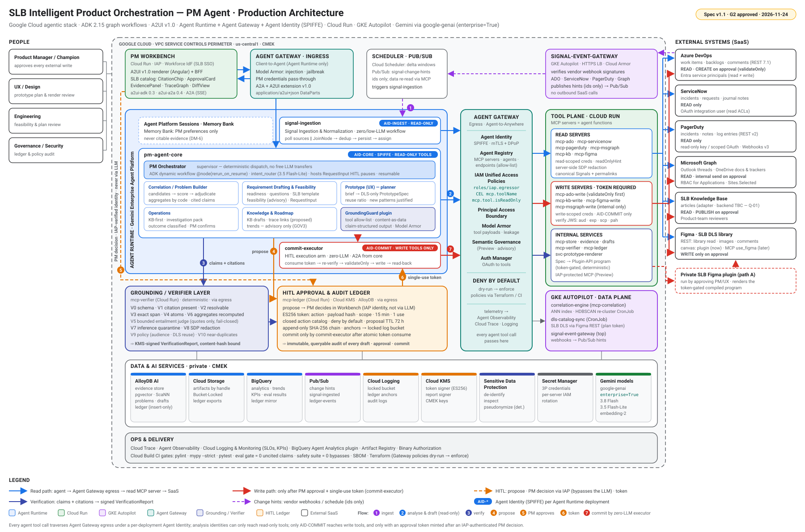
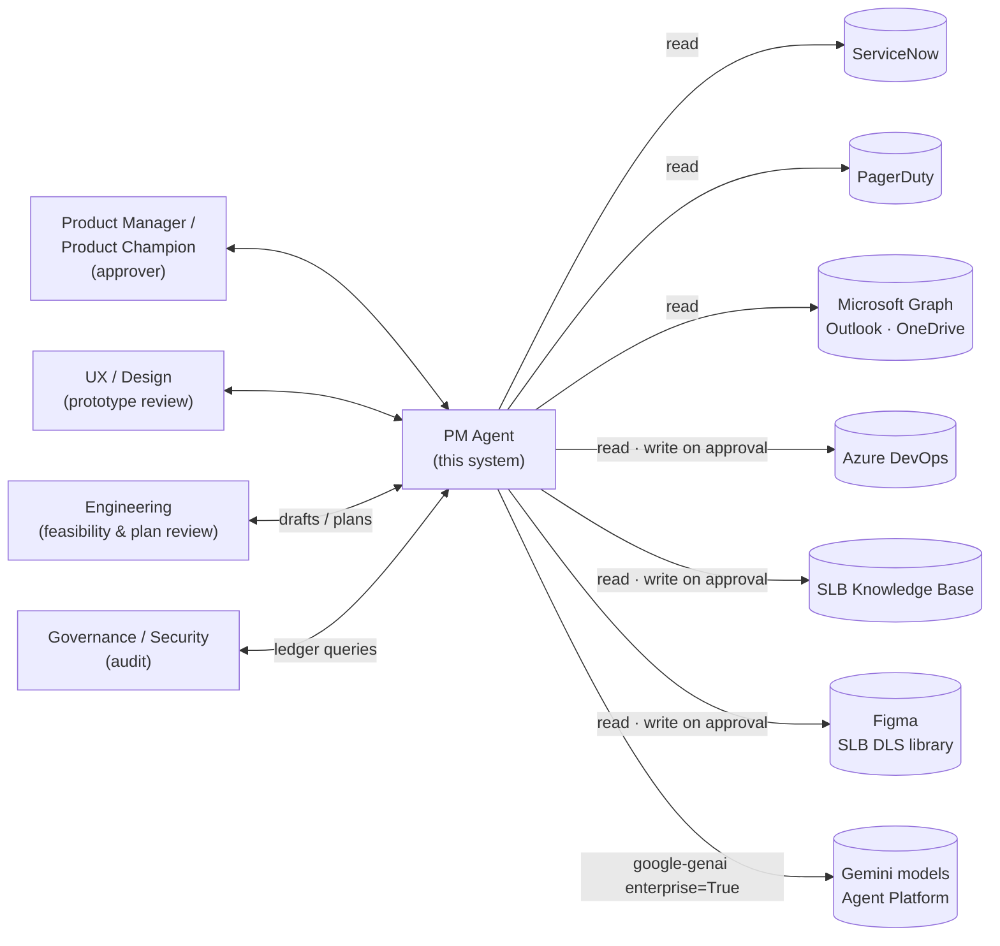
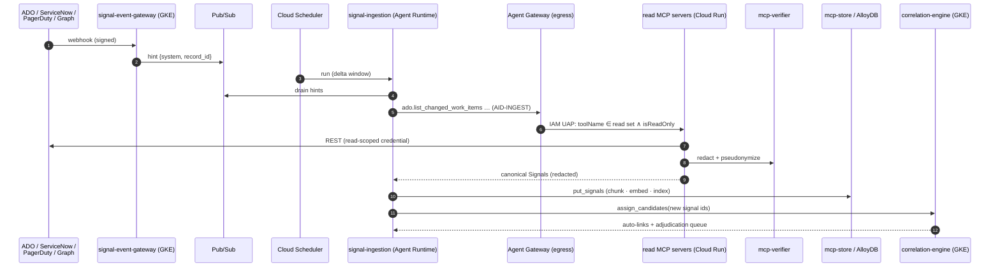

# 03 — System Architecture

> **Intelligent Product Orchestration for SLB Product Management.** A governed multi-agent system on Google Cloud's agentic stack: ADK 2.x agents on **Agent Runtime** (Gemini Enterprise Agent Platform), tool servers on **Cloud Run**, streaming/batch data-plane containers on **GKE Autopilot**, every agent tool call brokered by **Agent Gateway** under a per-deployment **Agent Identity** (SPIFFE), every fact gated by the **Verifier**, every write gated by the **HITL Ledger**, and the PM experience delivered through **A2UI**.

---

## 1. System context

---

## 2. Planes and containers

| Plane | Container | Runtime | Identity | Responsibility |
|---|---|---|---|---|
| **Experience** | `pm-workbench` | Cloud Run + **IAP** (Workforce Identity Federation → SLB IdP) | `SA-WORKBENCH` | A2UI renderer (SPA) + BFF: A2A client to Agent Gateway ingress, SSE to browser, **direct** approval calls to `mcp-ledger.decide` with the PM's IAP identity |
| **Agent** | `pm-agent-core` | **Agent Runtime** | `AID-CORE` (read-only tools) | PM Orchestrator + Problem Builder, Requirement Drafting & Feasibility, Prototype planner, Operations, Knowledge & Roadmap |
| | `signal-ingestion` | **Agent Runtime** | `AID-INGEST` | Continuous ingestion, normalization, dedup (zero/low LLM) |
| | `commit-executor` | **Agent Runtime** | `AID-COMMIT` (write tools only) | Zero-LLM execution of approved actions |
| **Tool** ("agent functions") | `mcp-ado` · `mcp-servicenow` · `mcp-pagerduty` · `mcp-msgraph` · `mcp-kb` · `mcp-figma` | Cloud Run (internal ingress, IAP-protected MCP) | one SA each, **read-scoped** third-party credentials | Read connectors: normalize → redact (SDP) → return canonical `Signal`s / search results |
| | `mcp-ado-write` · `mcp-kb-write` · `mcp-figma-write` · `mcp-msgraph-write` | Cloud Run | one SA each, **write-scoped** credentials | Write tools; verify approval token before any call |
| | `mcp-store` · `mcp-verifier` · `mcp-ledger` | Cloud Run | `SA-STORE` · `SA-VERIFIER` · `SA-LEDGER` | Evidence/problem/draft store API · Grounding/Verifier · HITL ledger + KMS token minting |
| | `svc-prototype-renderer` | Cloud Run | `SA-RENDER` | Compiles approved `PrototypeSpec` → Plugin-API program; serves it (token-gated) to the private SLB Figma plugin (ADR-006) |
| **Data plane** | `signal-event-gateway` | **GKE Autopilot** (public HTTPS LB + Cloud Armor) | KSA → WIF | Receives ADO service hooks, ServiceNow outbound REST, PagerDuty Webhooks v3, Graph change notifications; verifies signatures; publishes **hints only** to Pub/Sub |
| | `correlation-engine` (`mcp-correlation`) | **GKE Autopilot** (internal) | KSA → WIF | In-memory ANN candidate index, scoring, periodic HDBSCAN re-clustering (CronJob), dedup index maintenance |
| | `dls-catalog-sync` | **GKE Autopilot** CronJob | KSA → WIF | Snapshots the SLB DLS library (components, component sets, styles, variables) via Figma REST into the store |
| **Data** | AlloyDB (AlloyDB AI), GCS, BigQuery, Pub/Sub, Cloud Logging (locked bucket), Secret Manager, Cloud KMS, Agent Platform Sessions & Memory Bank | managed | per-service roles | See [10 §7](10-data-model-and-storage.md#7-physical-storage) |
| **Security** | Agent Gateway (ingress + egress), Agent Registry, Agent Identity (+ Auth Manager), IAM Unified Access Policies + PAB, Model Armor, Semantic Governance (Preview), SDP, VPC-SC, IAP, Cloud Armor | managed | — | See [08](08-security-identity-and-governance.md) |
| **Models** | Gemini 3.8 Flash · 3.5 Flash-Lite · gemini-embedding-2 | Agent Platform via `google-genai` (`enterprise=True`) | caller's identity | Drafting, extraction, classification, adjudication, bounded entailment judge, embeddings (ADR-008) |
| **Ops** | Cloud Trace / Logging / Monitoring, Agent Observability, Cloud Build, Artifact Registry, Binary Authorization, Terraform | managed | CI SA via WIF | See [12](12-deployment-and-operations.md) |

### 2.1 Why this runtime placement (summary of ADR-002)

| Runtime | Chosen for | Deciding facts (verified) |
|---|---|---|
| **Agent Runtime** | All ADK agents | Only runtime documented with **both** Agent Gateway ingress and egress; Agent Identity via `identity_type=AGENT_IDENTITY`; managed Sessions/Memory Bank; tracing on by default; long-running operations up to 7 days (multi-day HITL pauses) |
| **Cloud Run** | Stateless "agent functions": MCP tool servers, verifier, ledger, workbench, renderer | Request-scoped, scale-to-zero, per-service identity; documented as an **IAP-protected MCP destination** (`--functional-type=mcp-server`, Preview) reachable through Agent Gateway egress |
| **GKE Autopilot** | Always-on public webhook fan-in, stateful in-memory correlation index, long batch re-clustering and catalog sync CronJobs | Long-lived processes, memory-heavy pods, CronJobs, static egress/ingress controls; WIF principals are accepted in Agent Gateway IAM policies |

---

## 3. Key flows

### 3.1 Continuous ingestion (DONE-1)

### 3.2 Problem → requirement → approved ADO work item (DONE-2, DONE-3, DONE-5)

See the full sequence in [07 §4](07-hitl-approval-and-audit-ledger.md#4-end-to-end-protocol). Summary: `requirement_drafter` drafts claim-structured fields → `mcp-verifier` signs PASS → `mcp-ledger.propose` → A2UI ApprovalCard → PM approves in the Workbench (IAP identity, not via LLM) → KMS-signed single-use token → `commit-executor` (zero-LLM) re-verifies, runs ADO `validateOnly=true`, then creates the work item → ledger `COMMIT_SUCCEEDED`.

### 3.3 Prototype (DONE-4)

`prototype_planner` composes a `PrototypeSpec` exclusively from SLB DLS component keys (from `dls-catalog-sync` snapshot) → Verifier V9 → approval (PM + UX) → `svc-prototype-renderer` compiles the spec into a deterministic Plugin-API program → rendered into Figma by the private SLB plugin (available today) or by the remote Figma MCP `use_figma` tool once SLB's client is admitted to the Figma MCP Catalog (ADR-006) → screenshots via REST → validation package → release approval.

---

## 4. Assess-before-mutation isolation (R2) — four independent layers

| Layer | Mechanism | Defeats |
|---|---|---|
| **L1 Toolsets** | Analysis agents are constructed with read-only MCP toolsets; write tools are not even registered in `pm-agent-core` | Model choosing a write tool |
| **L2 Identity + Gateway** | Agent Gateway egress: `roles/iap.egressor` for `AID-CORE`/`AID-INGEST` only with CEL `mcp.tool.isReadOnly == true` on external connectors; write servers only grant `AID-COMMIT` by exact `mcp.toolName` | Compromised agent process / prompt injection |
| **L3 Token** | Write servers and the executor require a KMS-signed, single-use, payload-hash-bound approval token minted only after an IAP-authenticated PM decision | Stolen executor access; replay; payload swap |
| **L4 Ledger** | Append-only, hash-chained, anchored audit of every step; nightly control query "COMMIT without TOKEN_CONSUMED" must return 0 | Undetected bypass |

---

## 5. Network & perimeter

* **VPC Service Controls** perimeter around the project(s): Agent Platform / Agent Runtime (`aiplatform.googleapis.com`), Agent Registry, AlloyDB, BigQuery, GCS, Pub/Sub, Secret Manager, KMS, SDP, Model Armor, Cloud Run, Artifact Registry. Agent Gateway enforces VPC-SC only for gateways created after 2026-09-08 with an **agent connectivity template in `ALL_TRAFFIC` mode** — we create gateways that way from day one (NFR-2).
* Agent Runtime deployments use **PSC interface** (`psc_interface_config`) into the shared VPC; AlloyDB private IP; Cloud Run services `ingress=internal` + IAP for MCP; GKE private cluster (control plane private endpoint).
* The **only public ingress** points: `pm-workbench` (IAP) and `signal-event-gateway` (external HTTPS LB + Cloud Armor allow-lists/rate limits + per-vendor signature verification). Neither exposes data.
* **Egress** to SaaS happens only from the connector MCP servers (Cloud NAT with static IPs so SLB's ServiceNow/ADO conditional-access allow-lists can pin them) and from Agent Gateway egress for remote MCP endpoints.

---

## 6. Resilience & degradation (NFR-8, IR3, requirements §13)

| Failure | Behaviour |
|---|---|
| One connector down / auth failure | Source marked unavailable; problem views labelled *partial — <source> unavailable*; ingestion of other sources continues; never fabricated |
| Gemini endpoint unavailable / quota | Workflows pause with a clear error card; no partial drafts; retries with backoff (`retry_options`) |
| Verifier unavailable | Fail closed: no proposals, no factual chat answers |
| Ledger/KMS unavailable | No approvals or commits; drafts remain pending |
| Agent Gateway policy misconfiguration | Rolled out via CI in **dry-run** first; enforce only after zero unexpected denials over the soak window |
| Region outage (us-central1) | Documented DR runbook: redeploy to a secondary region from Terraform; AlloyDB cross-region replica; RPO ≤ 15 min, RTO ≤ 4 h (to confirm) |

---

## 7. Required services → where they are used

| Required service | Purpose in this design | Where |
|---|---|---|
| Azure DevOps API | Read backlogs/work items/comments; create work items on approval | `mcp-ado`, `mcp-ado-write`, ADO service hooks → `signal-event-gateway` |
| ServiceNow API | Incidents, requests, journal (comments/work notes) | `mcp-servicenow`, outbound REST → `signal-event-gateway` |
| PagerDuty API | Incidents, notes, log entries | `mcp-pagerduty`, Webhooks v3 → `signal-event-gateway` |
| Microsoft Graph API | Mail threads, OneDrive documents/trackers (read); internal outreach send on approval | `mcp-msgraph`, `mcp-msgraph-write`, change notifications |
| Figma API | DLS catalog (REST read), screenshots, validation comments (REST write on approval); canvas rendering via Plugin API / remote MCP | `mcp-figma`, `mcp-figma-write`, `dls-catalog-sync`, `svc-prototype-renderer` |
| SLB Knowledge Base API | KB-first search; publish on approval (adapter, backend TBC) | `mcp-kb`, `mcp-kb-write` |
| Google Gen AI SDK | All model calls (`enterprise=True`, Agent Platform) | ADK model layer, verifier judge, embeddings |
| Agent Gateway API | Ingress for the Workbench; egress for every agent tool call; Model Armor attachment | Gateway resources `gcloud network-services agent-gateways` |
| Agent Identity API | SPIFFE identities per Agent Runtime deployment; Auth Manager for OAuth to tools | `AID-CORE`, `AID-INGEST`, `AID-COMMIT` |
| GKE API | Data-plane containers | `signal-event-gateway`, `correlation-engine`, `dls-catalog-sync` |
| Cloud Run API | Agent functions / tool servers / workbench | all `mcp-*`, `svc-*`, `pm-workbench` |

---

## 8. Reconciliation with the workspace reference guides

| Reference pattern (`architecture.md`, `sequential_multi_agent_development_guide.md`) | Realization here |
|---|---|
| Supervisor architecture | `pm_orchestrator` dynamic workflow (deterministic dispatch) |
| Agent router (intent-based) | `intent_router` single-turn classifier with a closed capability list |
| Shared epistemic memory | The **Evidence Store** (AlloyDB) — citable, provenance-preserving. Memory Bank is limited to preferences (DM-6) because its memories are model-generated and not citable |
| Reactive streaming controller (SSE) | A2A streaming (SSE) between BFF and Agent Gateway ingress; A2UI messages carried as A2A DataParts |
| Dynamic component factory | Official A2UI renderer with the basic catalog + an SLB custom catalog ([11](11-a2ui-pm-workbench.md)) |
| `onUiComponentDelivery` JSON-RPC frames | **Not part of A2UI** (verified: zero occurrences in spec/SDK); replaced by A2UI v1.0 `createSurface` / `updateComponents` / `updateDataModel` / `deleteSurface` |
| `a2a.types` DataPart/TextPart monkeypatch | Not needed: pin `a2a-sdk` to the range required by `a2ui-a2a` 0.4.0 (`>=0.3.0,<0.4.0`) — see [02](02-platform-verification-log.md) |
| Callback keyword `callback_context` | Confirmed for ADK 2.x agent callbacks |
| Sandboxed code execution | Not required (no generated code executes in our services); Figma programs are compiled deterministically, not model-written |
