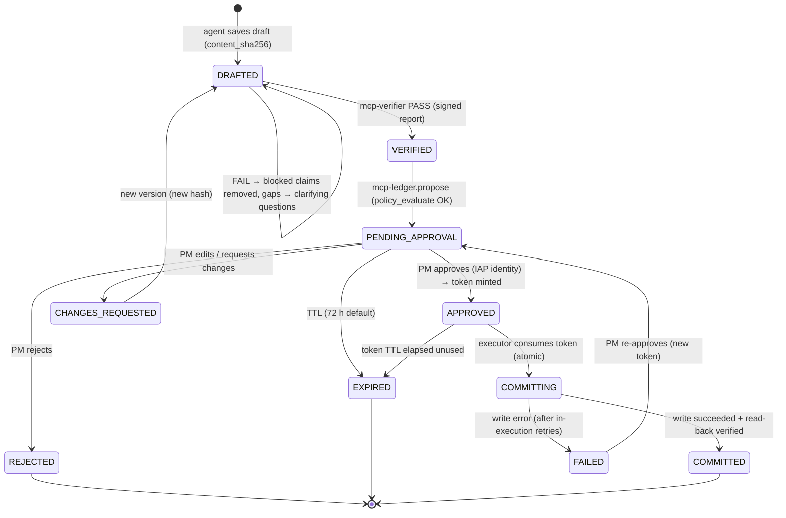

# 07 — HITL Approval & Audit Ledger

> **Mandate (R2, FR-A10, FR-B6, FR-C4, GOV1, GOV5, GOV6, NFR-5, AC3, AC6, AC9, AC10).** The agent never autonomously creates an ADO requirement, publishes knowledge, renders/shares a prototype, sends outreach, or commits a roadmap decision. Every state-changing action is **drafted → verified → proposed → approved by an authenticated human → executed by a separate, zero-LLM executor → recorded** in an immutable, queryable ledger.

---

## 1. Non-negotiable properties

| # | Property | How it is guaranteed |
|---|---|---|
| H-1 | **No write path without approval** | Write tools exist only on dedicated write MCP servers; Agent Gateway IAM policy lets **only** the `commit-executor` identity call them (by tool name); the servers also require a valid approval token ([08](08-security-identity-and-governance.md)). |
| H-2 | **Approvals come from humans, not models** | The *Approve* click goes from the PM Workbench BFF straight to `mcp-ledger.decide` with the PM's IAP-verified identity. It never transits an LLM. Agents receive only the outcome. |
| H-3 | **The LLM never holds signing material** | Tokens are signed by Cloud KMS (`approval-token-signer`); only the `mcp-ledger` service account has `cloudkms.signer` on that key. |
| H-4 | **Approve exactly what was shown** | The token binds `payload_sha256` (RFC 8785 canonical JSON) + `verification_report` hash. Any edit ⇒ new hash ⇒ new verification ⇒ new approval. |
| H-5 | **Single use, short-lived** | `jti` consumed atomically in the same DB transaction that writes `COMMIT_STARTED`; TTL 15 min (config). |
| H-6 | **Executor cannot be persuaded** | `commit-executor` is an ADK 2.x workflow of **function nodes only — zero model calls** — so prompt injection has no surface there. |
| H-7 | **Immutable, queryable audit** | Append-only table (DB role `INSERT, SELECT` only) + SHA-256 hash chain + periodic anchoring to a **locked** Cloud Logging bucket + daily signed exports to a **Bucket-Locked** GCS bucket. |

---

## 2. Action catalog (closed list — deny by default)

| `action_type` | Requirement | Target API call (executed by `commit-executor`) | Pre-flight (dry run) | Approver group (config) | Idempotency |
|---|---|---|---|---|---|
| `ADO_CREATE_WORK_ITEM` | FR-A10, AC3 | `mcp-ado-write.create_work_item` → `POST {org}/{project}/_apis/wit/workitems/${type}?api-version=7.1` (JSON Patch) | Same call with `validateOnly=true` | `pm-<product_line>` | Tag `pm-agent:<action_id>` + WIQL lookup before retry |
| `ADO_ADD_LINKS` | FR-C6 | `mcp-ado-write.add_relations` → `PATCH …/workitems/{id}` (`/relations/-`, `test /rev`) | `validateOnly=true` | `pm-<product_line>` | Relation existence check |
| `KB_PUBLISH_ARTICLE` | FR-C4, AC6 | `mcp-kb-write.publish_article` (adapter; Q-01) | Adapter `validate()` | `product-kb-reviewers` (Product-team review) | External id from adapter; `create_draft` then `publish` |
| `FIGMA_RENDER_PROTOTYPE` | FR-B2, ADR-006 | Releases the approved `PrototypeSpec` to the renderer (private Figma plugin, or remote MCP `use_figma` once approved) | Spec compiles; DLS keys resolve | `pm-<product_line>` + `ux-<product_line>` (configurable 2-of-2) | Spec hash → target file/page name |
| `FIGMA_POST_COMMENT` | FR-B4 | `mcp-figma-write.post_comment` → `POST /v1/files/{key}/comments` | Lint payload | `pm-<product_line>` | Comment marker with `action_id` |
| `PROTOTYPE_RELEASE_INTERNAL` | FR-B6 | Marks a `ValidationPackage` released to PM/UX (internal only — the agent never shares externally) | — | `pm-<product_line>` | Ledger state |
| `OUTREACH_SEND_INTERNAL` | FR-A6, GOV5 | `mcp-msgraph-write.send_mail` from the shared mailbox (internal recipients only, P-03) | Recipient policy check | requesting PM | `internetMessageId` header = `action_id` |
| `ROADMAP_TRACE_LINK` | FR-C6, R2 | Records a PM roadmap decision reference + trace links (internal) | — | `pm-<product_line>` | Link uniqueness |

> **Roadmap decisions** are made by the PM in the Workbench and recorded as `DECISION_RECORDED`; the agent can only *propose* the evidence links around them (GOV3).

---

## 3. Lifecycle of a `ProposedAction`



---

## 4. End-to-end protocol

```mermaid
sequenceDiagram
  autonumber
  participant PM as PM (browser)
  participant WB as pm-workbench BFF<br/>(Cloud Run + IAP)
  participant GWi as Agent Gateway<br/>(ingress)
  participant CORE as pm-agent-core<br/>(Agent Runtime)
  participant VER as mcp-verifier
  participant LED as mcp-ledger<br/>(+ Cloud KMS)
  participant GWe as Agent Gateway<br/>(egress)
  participant EXE as commit-executor<br/>(Agent Runtime, zero-LLM)
  participant ADOW as mcp-ado-write
  participant ADO as Azure DevOps

  PM->>WB: "Draft the requirement for prb_…"
  WB->>GWi: A2A message (PM credentials)
  GWi->>CORE: Model Armor screened request
  CORE->>CORE: requirement_drafter → RequirementDraft v3 (claims+citations)
  CORE->>GWe: verifier.verify_subject(draft v3)
  GWe->>VER: (AID-CORE allowed)
  VER-->>CORE: VerificationReport PASS (signed, subject_sha256)
  CORE->>LED: ledger.propose(ADO_CREATE_WORK_ITEM, payload, report)
  LED-->>CORE: action_id (PENDING_APPROVAL)
  CORE-->>WB: A2UI ApprovalCard surface + ADK human-input interrupt
  WB-->>PM: Draft, per-field citations, verifier badge, diff, risks
  PM->>WB: Approve (comment)
  WB->>LED: decide(action_id, approve) + IAP JWT (NOT via LLM)
  LED->>LED: verify JWT, approver ∈ group, report fresh, hash match
  LED->>LED: KMS asymmetricSign → ApprovalToken; ledger DECISION_RECORDED, TOKEN_ISSUED
  WB->>CORE: resume interrupt {action_id, decision: approved}
  CORE->>GWe: A2A → commit-executor.execute(action_id)
  GWe->>EXE: (AID-CORE → EXE allowed)
  EXE->>LED: consume_token(action_id) — atomic jti consume + COMMIT_STARTED
  EXE->>VER: re-verify subject_sha256 (must match token.pah)
  EXE->>GWe: ado_write.create_work_item(validate_only=true, token)
  GWe->>ADOW: (AID-COMMIT + toolName allowed)
  ADOW->>ADO: POST …/workitems/$Requirement?validateOnly=true
  EXE->>GWe: ado_write.create_work_item(validate_only=false, token)
  ADOW->>ADO: POST …/workitems/$Requirement
  ADO-->>ADOW: 200 {id, rev, url}
  EXE->>LED: COMMIT_SUCCEEDED {external_id, url} + trace links
  LED-->>WB: ledger-events (Pub/Sub) → UI shows "Committed: ADO #…"
```

**Why the resume carries no authority:** even if a compromised client forged a resume payload, the executor would fail at `consume_token` — no token exists without a recorded, IAP-authenticated decision.

---

## 5. Approver identity & authorization

| Aspect | Design |
|---|---|
| Authentication | PMs sign in to the Workbench through **IAP** using **Workforce Identity Federation** with SLB's IdP (Entra ID assumed — Q-08). `mcp-ledger.decide` is reachable only from the BFF and requires the forwarded `x-goog-iap-jwt-assertion`, re-validated (signature, `aud`, expiry) by the ledger. |
| Authorization | `config.approver_rules`: action type × product line → allowed IdP groups; optional **two-person rule** (e.g. `FIGMA_RENDER_PROTOTYPE` PM + UX; `KB_PUBLISH_ARTICLE` any 1 of `product-kb-reviewers`). **Group source (IaC review, 2026-11-24):** the IAP assertion carries `sub`, `workforce_identity.iam_principal` and (with the `google.email` mapping) `email`, but **no IdP groups** — membership must come from a separate lookup (e.g. Microsoft Graph or Cloud Identity groups). The code isolates this behind `GroupResolver` (`PlaceholderGroupResolver` until Q-08 is answered, [`hitl/identity.py`](../src/pm_agent/hitl/identity.py)). |
| Non-repudiation | `ApprovalDecision.authn_assertion_sha256` stores the hash of the exact IAP assertion; the decision is ledger-chained. |
| Separation of duties | The service identity that proposes (`AID-CORE`) cannot call `decide` (IAM) and cannot call write tools (Gateway). The reference code also refuses decisions whose subject equals the proposer or looks like an agent principal (`spiffe://`, `principal://agents.`). |
| Caller identity on `mcp-ledger` | The reference MCP server takes `proposed_by` / `consumer` / `actor_id` as tool arguments. **Production must derive them from the verified caller token only and reject calls without one**; which principal Agent Gateway forwards to Cloud Run MCP servers is UNCONFIRMED until the dev soak ([`infra/README.md`](../infra/README.md) §4). |

## 6. Approval token

```json
{
  "iss": "https://ledger.pm-agent.slb.internal",
  "sub": "principal://iam.googleapis.com/locations/global/workforcePools/slb/subject/<pm>",
  "aud": "commit-executor",
  "jti": "tok_01J9…",
  "iat": 1791820800, "exp": 1791821700,
  "act": "act_01J9…",
  "pah": "sha256:5b9e…",            
  "tgt": {"system": "ado", "org": "slb1-swt", "project": "Planck", "type": "Requirement"},
  "scp": ["ado_write.create_work_item"],
  "vrf": "sha256:c41d…"
}
```

* JWS `ES256`, signed with Cloud KMS `EC_SIGN_P256_SHA256` (`kid` = key version). Public key published to executor + write servers via config.
* Verified **twice**: by `commit-executor` (before anything) and by the write MCP server (defense in depth: `aud`, `exp`, `scp` contains the tool name, `pah` equals hash of the received payload).
* `jti` registry row (`hitl.tokens`) enforces single use; reject after approve ⇒ `revoked_at` set.
* **Binding (as implemented):** `pah` = RFC 8785 hash of the approved payload; `vrf` = `subject_sha256` of the verified draft (bookkeeping fields `verification_report_id`/`approval_state` excluded). The proposal itself is refused unless a signed, fresh, commit-bound PASS report covers *exactly* this `action_type`, subject type and `target_payload_sha256` ([`hitl/approvals.py`](../src/pm_agent/hitl/approvals.py)).
* Write servers accept any number of `validate_only` pre-flights per token but **one** real execution (`jti` burned on first execute, [`hitl/write_guard.py`](../src/pm_agent/hitl/write_guard.py)).

---

## 7. `commit-executor` workflow (zero-LLM)

| Node | Type | Behaviour |
|---|---|---|
| `load_action` | function | Read `ProposedAction` + payload by `action_id` |
| `consume_token` | function | `mcp-ledger.consume_token` (atomic; fails if used/expired/revoked) |
| `reverify` | function | `mcp-verifier.verify_subject` → `subject_sha256 == token.pah` and PASS |
| `policy_recheck` | function | `verifier.policy_evaluate` (policies may have changed since proposal) |
| `preflight` | function | Dry run (ADO `validateOnly=true`, KB `validate`, recipient policy) |
| `execute` | function | Single write tool call with idempotency marker |
| `read_back` | function | Re-read the created object; compare key fields to payload |
| `record` | function | `COMMIT_SUCCEEDED` / `COMMIT_FAILED` entry, trace links, Pub/Sub `ledger-events` |

Retries: exponential backoff for 429/5xx honoring `Retry-After` (ADO TSTU limits) **inside the single execution**. Before any retry of a create, the executor searches for the idempotency marker to avoid duplicates. Non-recoverable failures surface to the PM with the external error (redacted); a `FAILED` action needs a fresh approval, so one token can never back two writes.

> **Implementation note (reference code):** the steps above run inside **one** function node of the `commit_executor` workflow ([`executor_app/agent.py`](../src/pm_agent/executor_app/agent.py), steps in [`hitl/executor.py`](../src/pm_agent/hitl/executor.py)) so the approval token lives only in that node's memory and never enters session state, events or logs; node-level retries are disabled. `reverify` compares the new report's `subject_sha256` with the token's `vrf` and its `target_payload_sha256` with `pah`.

---

## 8. Ledger design

### 8.1 Table (AlloyDB, schema `hitl`)

| Column | Type | Notes |
|---|---|---|
| `seq` | `bigint` identity | Gap-free ordering within the chain |
| `entry_id` | `text` | `led_` + ULID |
| `entry_type` | `text` | see §8.3 |
| `subject_refs` | `jsonb` | `[{type:"requirement_draft", id, version, sha256}, …]` |
| `actor` | `jsonb` | `{type: agent|human|system, id: SPIFFE principal | workforce principal | service}` |
| `payload` | `jsonb` | Redacted details (ids, hashes, decisions, external ids) — never raw content |
| `prev_hash` | `bytea` | Hash of previous entry |
| `entry_hash` | `bytea` | `SHA-256(prev_hash ‖ JCS(entry without hashes))` |
| `recorded_utc` | `timestamptz` | DB time |
| `trace_id` | `text` | OpenTelemetry trace id (joins with Cloud Trace) |

* DB role `ledger_writer`: `INSERT, SELECT` only — no `UPDATE/DELETE/TRUNCATE`; DDL via break-glass only (audited).
* **Anchoring:** every 5 min the chain head `(seq, entry_hash)` is written to the locked Cloud Logging bucket `pm-agent-ledger`; nightly a signed segment export goes to the Bucket-Locked GCS bucket.
* **Integrity job:** hourly recomputation of the chain from the last anchor; mismatch ⇒ SEV-1 alert.

### 8.2 Query surfaces (AC10)

| Surface | Use |
|---|---|
| `mcp-ledger.query(filter)` | Agents (e.g. "has this problem already been proposed?") |
| Workbench *Audit* surface | PM / governance browsing with evidence drill-down |
| BigQuery (Log Analytics linked dataset) | Governance reporting, KPIs, audit exports |

```sql
-- Every draft, approval and commit for one problem (AC10)
SELECT seq, entry_type, actor->>'id' AS actor, payload->>'action_id' AS action_id, recorded_utc
FROM hitl.ledger_entries
WHERE subject_refs @> '[{"type":"product_problem","id":"prb_01J9..."}]'
ORDER BY seq;

-- Any write without a consumed token? (must return 0 rows — AC9 safety control)
SELECT c.payload->>'action_id' FROM hitl.ledger_entries c
WHERE c.entry_type = 'COMMIT_SUCCEEDED'
  AND NOT EXISTS (SELECT 1 FROM hitl.ledger_entries t
                  WHERE t.entry_type = 'TOKEN_CONSUMED'
                    AND t.payload->>'action_id' = c.payload->>'action_id');
```

### 8.3 Entry types

`DRAFT_SAVED`, `VERIFICATION_COMPLETED`, `ACTION_PROPOSED`, `ACTION_EXPIRED`, `DECISION_RECORDED`, `TOKEN_ISSUED`, `TOKEN_CONSUMED`, `TOKEN_REVOKED`, `COMMIT_STARTED`, `COMMIT_SUCCEEDED`, `COMMIT_FAILED`, `POLICY_DENIED`, `TOOL_CALL_DENIED` (from GroundingGuard / Gateway logs), `PM_INPUT_RECORDED`, `PROBLEM_MERGED`, `CONFIG_CHANGED`, `ANCHOR_WRITTEN`.

---

## 9. Edge cases

| Case | Handling |
|---|---|
| PM edits a field in the ApprovalCard | Edit is a `pm_input` signal → new draft version → re-verify → new proposal (old one `CANCELLED`) |
| Two PMs act concurrently | Optimistic locking on `ProposedAction.version`; the second decision gets `409` and a refreshed card |
| Executor crash after ADO accepted the write | Token already consumed; reconciliation job finds the idempotency tag via WIQL and writes `COMMIT_SUCCEEDED` |
| ADO work-item rules reject the payload | Pre-flight fails ⇒ `FAILED` with ADO message ⇒ agent proposes a fix as a new draft version |
| Approval granted but evidence deleted at source | Re-verify fails at commit ⇒ `CHANGES_REQUESTED` |
| Approval not granted | Draft stays pending; **no write**; logged (requirements §13) |

## 10. Acceptance mapping

| Criterion | Evidence produced |
|---|---|
| AC3 | Draft with per-field citations; `validateOnly` pre-flight; no ADO call before `TOKEN_CONSUMED`; `COMMIT_SUCCEEDED` with ADO id |
| AC6 | KB publish only after `product-kb-reviewers` decision |
| AC9 | Safety suite: every write tool called without token ⇒ refused at Gateway (identity) **and** server (token); positive controls succeed |
| AC10 | §8.2 queries return complete chains for all golden scenarios |
