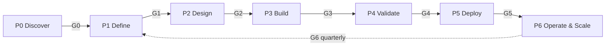

# 00 — Methodology & Phase Gates

> **About "AI Black Belt methodology".** No public, official Google document defining an "AI Black Belt methodology" with named phases and gates was found during verification ([02 §2.9](02-platform-verification-log.md#29-methodology)). This document therefore **operationalizes** it as an explicit, auditable phase-gate lifecycle for taking the PM Agent from concept to production, combining the workspace's vibe-coding principles (`GEMINI.md`), the FCoT reasoning protocol (`FCot2.md`), and the phased rollout in `PM_Agent_Requirements.md` §17. If SLB/Google provide an internal Black Belt playbook, gates will be re-mapped without changing the artifacts.

---

## 1. Objective functions (FCoT dual optimization)

| | Optimize | Measured by |
|---|---|---|
| **f_max** | Grounded signal coverage · requirement completeness · knowledge reuse · roadmap traceability · PM leverage (O1–O5) | KPIs in requirements §3.3 (linkage ≥ 80 %, first-pass acceptance ≥ 60 %, context-gathering time −40 %, KB reuse ≥ 50 %, evidence completeness ≥ 90 %) |
| **f_min** | Uncited claims · unauthorized mutations · duplicate work · rework loops (G1–G4) | Uncited claims in approved outputs = **0**; unauthorized writes = **0**; near-duplicate creations → 0; clarification loops after Engineering review ↓ |

Penalty on f_min scales up as work moves from design (macro) to code (micro): a design gap costs a review comment; a code gap fails CI.

---

## 2. Phase model

| Phase | Objective | Key artifacts | Exit gate (all must hold) | Gate owners |
|---|---|---|---|---|
| **P0 Discover** | Confirm problem, value, access, constraints | Pain-point corpus, connector list, stakeholder map | Business sponsor named; connector access path known; perimeter constraints known | SLB Product lead · Google AI Black Belt |
| **P1 Define** | Testable requirements & success metrics | `PM_Agent_Requirements.md` (v1.0 draft), metric baselines plan | Requirements reviewed; HITL & grounding constraints accepted; baselines plan agreed | SLB PM lead · Security |
| **P2 Design** | Production architecture & verified platform choices | **This spec** (`docs/00–16`), architecture diagram, ADRs, verification log, eval plan, threat model | Spec approved; diagram approved; ADRs accepted; every ❓ item has an owner + spike milestone; open questions triaged | SLB PM lead · SLB Architecture · Security · Google |
| **P3 Build** | Incremental, test-first implementation | Code, tests, eval suites, Terraform, runbooks (per milestone, [14](14-implementation-roadmap.md)) | Milestone DoD met: unit/contract/component tests green; eval gates green in replay; lint/type clean; demo accepted | Tech lead · PM lead |
| **P4 Validate** | Prove quality, safety & value on SLB data | Stage deployment, E1–E8 live results, UAT findings, security review, Gateway dry-run report | E3 uncited = 0 and E6 violations = 0 **live**; UAT sign-off by pilot PMs; pen-test/critical findings closed; Gateway dry-run shows 0 unexpected denials | PM pilot group · Security · SLB Architecture |
| **P5 Deploy** | Safe production rollout | Prod Terraform, Gateway **enforce**, SLOs, on-call, DR test | Production readiness review passed (SLOs, alerts, runbooks, DR drill, data-handling sign-off); progressive rollout plan approved | SRE · Security · Sponsor |
| **P6 Operate & Scale** | Sustain and grow value | KPI dashboards, eval trend, incident reviews, backlog | Quarterly: KPIs vs targets; eval drift within bounds; new connectors/products via P1–P5 mini-cycle | Product council |

---

## 3. Gate status (as of 2026-11-24)

| Gate | Status | Evidence / gaps |
|---|---|---|
| G0 | 🟡 Passed with gaps | Corpus + connector list present; **metric baselines not yet captured**; pilot product line not named (Q-12 — placeholder) |
| G1 | 🟡 Passed with open items | Requirements v1.0 draft; open items §15.4 carried into [15](15-risks-assumptions-open-questions.md) |
| **G2** | ✅ **Approved 2026-11-24** | Spec, diagram and all ADRs accepted (ADR-007 revised to A2UI v1.0). Goal confirmed as a **reference architecture**: SLB-specific unknowns are carried as tracked placeholders (`PLACEHOLDERS.md`) rather than blocking |
| G3 | 🔄 In progress | Reference implementation, milestone M0 (scaffold, schemas, verifier, HITL core, ADK skeletons, Terraform skeleton) |
| G4–G6 | ⬜ Not started | — |

---

## 4. Delivery increments (each passes G3 → G4 → G5)

| Release | Scope (requirements §17 phase) | DONE criteria covered |
|---|---|---|
| **R1 Signal → Problem** (Phase 1, read-only) | Connectors (read), ingestion, redaction, dedup, correlation, problem views, readiness & questions | DONE-1, DONE-2 |
| **R2 Drafting + HITL commit** (Phase 2) | Requirement drafting & feasibility, Verifier V0–V10, ledger, approval tokens, commit executor, ADO writes | DONE-3, DONE-5, DONE-6, DONE-7, DONE-8 |
| **R3 Operations & Knowledge** (Phase 3) | Investigation packs, outcome classification, KB drafting/publish, traceability, trends | DONE-5, DONE-6 (KB), AC5–AC7 |
| **R4 Prototype validation** (Phase 4) | DLS catalog sync, prototype brief/spec, renderer (plugin path), validation packages, feedback loop | DONE-4 |
| **R5 Scale & learn** (Phase 5) | Extension channels, more product lines, Figma MCP path B, tuning | — |

Platform foundations (Terraform, perimeter, Gateway in dry-run, identities, CI gates — DONE-8/9) are built in **M0** and hardened in every release.

---

## 5. Operating principles (from `GEMINI.md`)

| Principle | How it shows up |
|---|---|
| Natural language is the source of truth | This spec (markdown-first) is the contract; code changes that diverge require a spec/ADR update in the same PR |
| Run > Read (TDD) | Tests before implementation for every task; eval gates for every model-dependent behaviour |
| Iterative & incremental | Milestones of 1–2 weeks with small PRs; no monolithic modules |
| Error-driven development | Failing test output / stack traces fed back verbatim; no speculative fixes |
| Check-in at functional milestones | At each milestone the team is prompted to confirm a Git commit/push to GitHub (no automatic pushes) |

## 6. Review cadence & RACI (proposed)

| Activity | Responsible | Accountable | Consulted | Informed |
|---|---|---|---|---|
| Gate reviews | Tech lead | SLB PM lead | SLB Architecture, Security | Sponsor |
| ADR approval | Architect | SLB Architecture | Security, PM lead | Team |
| Eval threshold changes | ML lead | SLB PM lead | Security | Team |
| Gateway / IAM policy changes | Platform engineer | Security | Architect | SRE |
