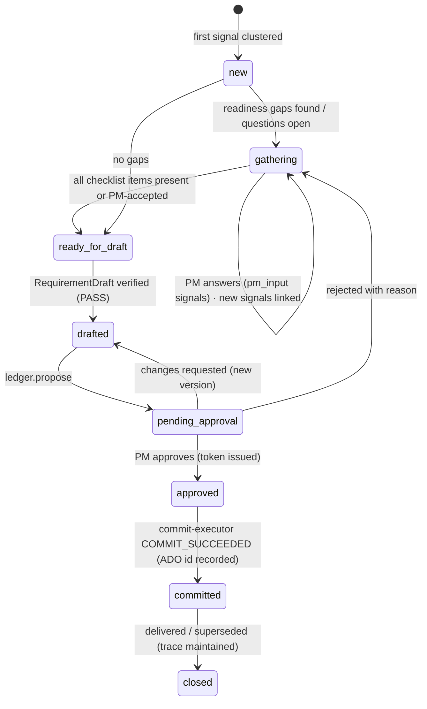
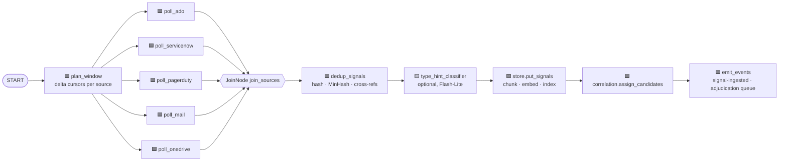
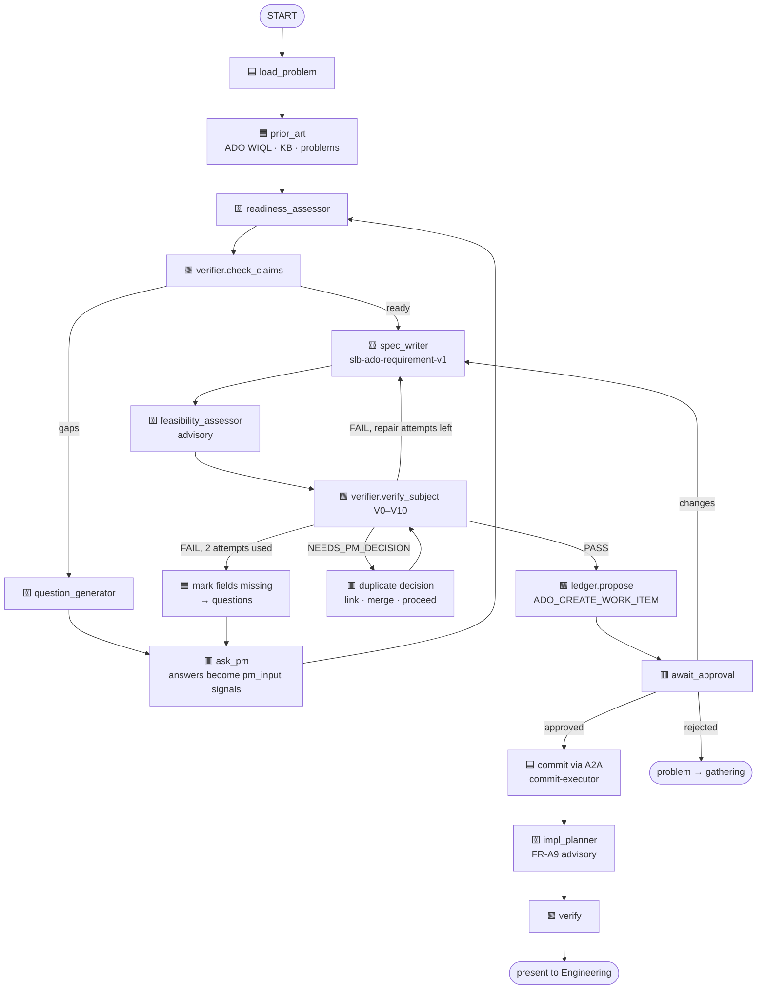

# 05 — Orchestration & Workflows (ADK 2.x)

> How the roster in [04](04-agent-roster.md) executes. All constructs below were verified against adk.dev for **google-adk 2.11.0** and re-verified against the installed **google-adk 2.15.0** on 2026-11-24 (see [02 §4](02-platform-verification-log.md#4-re-verification-2026-11-24-after-g2-approval)). Code blocks are **design sketches** that fix names and control flow; the reference implementation under `src/pm_agent/` follows them.

---

## 1. ADK applications and how they talk

| ADK `App` | Runtime | Root | Invoked by | Talks to |
|---|---|---|---|---|
| `pm_agent_core` | Agent Runtime (`identity_type=AGENT_IDENTITY`, `agent_gateway_config` set at first deploy — both immutable) | `Workflow(edges=[("START", pm_orchestrator)])` | PM Workbench via Agent Gateway **ingress** (A2A + A2UI extension); Cloud Scheduler for background problem-building | MCP servers and `commit-executor` via Agent Gateway **egress** |
| `signal_ingestion` | Agent Runtime | `Workflow` (§4.1) | Cloud Scheduler (delta windows); drains Pub/Sub `signal-change-hints` | Read connector MCP servers, `mcp-store`, `mcp-correlation`, `mcp-verifier` via egress |
| `commit_executor` | Agent Runtime | zero-LLM `Workflow` (§4.7) | `pm_agent_core` over **A2A** through Agent Gateway (agent-to-agent egress policy) | Write MCP servers, `mcp-ledger`, `mcp-verifier` via egress |

Shared on every `App`: `GroundingGuardPlugin`, `ModelArmorPlugin`, `LoggingPlugin`, `BigQueryAgentAnalyticsPlugin`, `ResumabilityConfig(is_resumable=True)`.

---

## 2. Product Problem lifecycle



State transitions are written **only** by function nodes (never by an LLM) and each emits a ledger entry.

---

## 3. PM Orchestrator (supervisor)

```python
# design sketch — imports verified for google-adk 2.11, re-verified against installed 2.15.0 (2026-11-24)
from google.adk import Agent, Workflow, Context
from google.adk.workflow import node
from google.adk.apps import App, ResumabilityConfig

intent_router = Agent(
    name="intent_router",
    model="gemini-3.5-flash-lite",          # pinned id (no *-latest on us-central1)
    mode="single_turn",
    include_contents="none",
    instruction=INTENT_INSTRUCTIONS,        # closed list of capabilities, refuse anything else
    output_schema=Intent,                   # {capability, problem_id?, signal_id?, args}
)

CAPABILITIES = {                            # deterministic dispatch table (no LLM transfer)
    "ask": answer_question_wf,              # pm_assistant: claim-structured Q&A over evidence
    "review_problems": problem_inbox_wf,
    "build_problem": problem_builder_wf,
    "define_requirement": define_requirement_wf,
    "design_prototype": prototype_wf,
    "investigate_issue": investigation_wf,
    "capture_knowledge": knowledge_wf,
    "trace_roadmap": trace_wf,
    "surface_trends": trends_wf,
}

@node(rerun_on_resume=True)                 # required for orchestrators calling ctx.run_node
async def pm_orchestrator(ctx: Context, node_input: PMRequest):
    intent = await ctx.run_node(intent_router, node_input)
    workflow = CAPABILITIES.get(intent.capability, clarify_wf)
    return await ctx.run_node(workflow, intent)   # completed children are checkpointed

root_agent = Workflow(name="pm_agent_core", edges=[("START", pm_orchestrator)])
app = App(name="pm_agent_core", root_agent=root_agent,
          plugins=PLUGINS, resumability_config=ResumabilityConfig(is_resumable=True))
```

Why a dynamic workflow rather than an LLM coordinator: the supervisor must be loop-free, auditable and resumable across multi-day HITL pauses; ADK 2.x checkpoints `ctx.run_node` children so a resumed invocation skips completed work.

---

## 4. Capability workflows

Legend for all diagrams: 🟦 function node (code) · 🟨 LLM node (single-turn, schema-bound) · 🟥 `RequestInput` (human pause) · 🟩 verifier/ledger call.

### 4.1 W1 — Signal ingestion (`signal_ingestion` app)



* Connector tools return **already-redacted** canonical `Signal`s (server-side SDP), so no node handles raw text.
* Each poll node catches only connector-specific errors and returns `{source, status: unavailable, reason}` — never a broad `except` (ADK 2.0 retry semantics, see §6).

### 4.2 W2 — Problem builder

```python
problem_builder_wf = Workflow(name="problem_builder", edges=[
    ("START", get_candidates, score_candidates),
    (score_candidates, {"AUTO_LINK": link_signal,         # score ≥ 0.82 or hard cross-ref
                        "ADJUDICATE": link_adjudicator,   # 0.65–0.82 → 🟨 cited LinkDecision
                        "NEW": create_problem}),          # < 0.65
    (link_adjudicator, apply_link_decision),
    (link_signal, aggregate), (apply_link_decision, aggregate), (create_problem, aggregate),
    (aggregate, problem_characterizer, verify_claims, upsert_problem),
])
```

`aggregate` (code) computes `affected_customers`, `affected_regions`, `request_frequency` as `Claim(kind=aggregate)` with one citation per counted signal. `problem_characterizer` (🟨) produces title, classification (+ confidence), impact claims. `verify_claims` (🟩 `verifier.check_claims`, full mode) removes any claim failing V1–V5 before persistence.

### 4.3 W3 — Define requirement (`requirement_drafter`)



```python
# design sketch — human pause and authoritative re-read
from google.adk.events import RequestInput

async def await_approval(node_input: ProposedActionRef):
    yield RequestInput(message="Approval required", payload=node_input,
                       response_schema=ApprovalOutcome)   # {action_id, decision}

async def commit_if_approved(ctx: Context, node_input: ApprovalOutcome):
    action = await ledger.get_action(node_input.action_id)  # authoritative, never trust the resume payload
    if action.status != "APPROVED":
        return Event(route="NOT_APPROVED")
    return await commit_executor_client.execute(action.action_id)   # A2A via Agent Gateway
```

Loop bounds: every back-edge carries an attempt counter in session state (`temp:` for per-invocation, problem-scoped keys otherwise); ADK does **not** bound loops automatically.

### 4.4 W4 — Prototype validation (`prototype_planner`)

```mermaid
flowchart LR
  S([START]) --> G[🟦 guard: requirement approved]
  G --> B[🟨 experience_translator<br/>PrototypeBrief]
  B --> DLS[🟦 figma.search_dls<br/>SLB DLS catalog]
  DLS --> SC[🟨 spec_composer<br/>PrototypeSpec]
  SC --> V[🟩 verify V9: keys · reuse · justifications]
  V --> P1[🟩 propose FIGMA_RENDER_PROTOTYPE]
  P1 --> H1[🟥 approve render<br/>PM + UX]
  H1 --> RX[🟦 executor renders<br/>compiled Plugin-API program]
  RX --> IMG[🟦 figma.render_images]
  IMG --> VP[🟦 ValidationPackage]
  VP --> P2[🟩 propose PROTOTYPE_RELEASE_INTERNAL<br/>+ FIGMA_POST_COMMENT]
  P2 --> H2[🟥 approve release]
  H2 --> FB[🟦 feedback loop<br/>FILE_COMMENT webhooks → signals]
  FB -->|revision| SC
```



### 4.5 W5 — Investigate issue (`operations_analyst`)

```python
investigation_wf = Workflow(name="investigation", edges=[
    ("START", kb_first, correlate_related, assemble_pack, engagement_advisor,
     outcome_classifier, confirm_outcome),                 # confirm_outcome yields RequestInput
    (confirm_outcome, {"DEFECT": draft_bug_wf,             # → W3 with bug template
                       "NON_DEFECT": define_requirement_wf,
                       "WORKAROUND": knowledge_wf,
                       "WORKFLOW_CLARIFICATION": knowledge_wf,
                       "NONE": close_pack}),
])
```

`kb_first` runs before anything else so a known resolution is surfaced immediately (FR-C5, AC5).

### 4.6 W6/W7 — Knowledge capture, traceability, trends (`knowledge_roadmap_curator`)

| Sub-workflow | Path |
|---|---|
| **K** knowledge | `guard(approved resolution)` → 🟨 `kb_writer` → 🟩 `near_duplicates(KB)` → 🟩 `verify_subject` (audience policy P-04) → 🟩 `propose(KB_PUBLISH_ARTICLE)` → 🟥 `await_approval` (product-kb-reviewers) → 🟦 commit |
| **T** traceability | 🟦 `on_store_event` (deterministic links: signal→problem, problem→ADO id, resolution→KB id) → 🟨 `trace_linker` (semantic links, status `proposed`) → 🟥 PM confirm → 🟦 `trace.confirm` |
| **R** trends | 🟦 `analytics.run_named_query` (allow-listed BigQuery views) → 🟨 `trend_narrator` (claims cite aggregate rows) → 🟩 verify → advisory brief |

### 4.7 Commit executor (`commit_executor` app — zero LLM)

```python
commit_executor_wf = Workflow(name="commit_executor", edges=[
    ("START", load_action, consume_token, reverify, policy_recheck, preflight),
    (preflight, {"OK": execute, "FAIL": record_failure}),
    (execute, {"OK": read_back, "RETRYABLE": backoff_and_retry, "FAIL": record_failure}),
    (backoff_and_retry, execute),           # bounded by state counter + idempotency marker lookup
    (read_back, record_success),
])
```

Every node is a Python function; there is no `Agent` in this app, so there is no model to inject.

---

## 5. Human-in-the-loop mechanics

| Topic | Design | Verified basis / flag |
|---|---|---|
| Pause | Nodes `yield RequestInput(message, payload, response_schema)`; surfaced to the client as the synthetic function call `adk_request_input` | adk.dev/graphs/human-input |
| Resume | Client answers the call; with `ResumabilityConfig(is_resumable=True)` the invocation resumes by `invocation_id`; `rerun_on_resume=True` on orchestrating nodes, default `False` on leaf pauses | adk.dev/runtime/resume · **exact Python FunctionResponse payload: UNCONFIRMED** — contract-tested in M1 |
| Authority | Resume payload is a *hint*; the next node re-reads the decision from `mcp-ledger` | Design rule H-2 |
| Duration | Pauses may last days (approvals); Agent Runtime long-running operations up to 7 days; beyond that the PM re-opens from the ledger (idempotent) | GCP release notes |
| Idempotency | "Tools run at least once" on resume ⇒ all tool calls with side effects carry idempotency keys | adk.dev/runtime/resume |
| Not used | ADK tool confirmation (`require_confirmation`) — unsupported with `VertexAiSessionService` | adk.dev/tools-custom/confirmation |

---

## 6. ADK 2.x engineering rules (from the 2.0 migration notes)

1. No custom `_run_async_impl` overrides (silently bypassed by the Workflow engine) — use nodes and callbacks.
2. Never append to `session.events` or call `enqueue_event`; **yield** events.
3. Never catch `BaseException` (traps `NodeInterruptedError`); no broad `except Exception` in tools — let the framework retry (`RetryConfig(max_attempts=3)` on flaky nodes).
4. One `output` per node run; user-visible text via `Event(message=…)`; state via `Event(state=…)`.
5. LLM nodes inside graphs run `mode="single_turn"` (task mode inside graphs was disabled in 2.0 — re-check per upgrade).
6. Callback/plugin signatures use the exact keyword names (`callback_context`, `llm_request`, `tool`, `args`, `tool_context`; plugin hooks are keyword-only).

## 7. State, memory and context

| Scope | Keys (examples) | Store |
|---|---|---|
| Session | `problem_id`, `active_surface_ids`, `pending_action_ids` | Agent Platform Sessions |
| `temp:` | `temp:attempts.spec_writer`, `temp:evidence_pack_ids` | invocation only |
| `user:` | `user:product_lines`, `user:approver_groups` (from IdP claims, read-only) | Sessions |
| `app:` | `app:config_versions` | Sessions |
| Memory Bank | PM preferences (template variants, tone, default product line) | **non-evidential** (DM-6) |

Evidence never travels through session state in bulk: nodes pass `evidence_id`s; LLM nodes receive curated evidence packs (≤ N chunks, ranked) built by code. Context caching (`ContextCacheConfig`) is enabled for the stable instruction + template prefix; event compaction keeps long HITL sessions bounded.

## 8. Latency budget (NFR-6, near-interactive single problem)

| Step | Budget (p95) |
|---|---|
| Intent routing (Flash-Lite) | 0.8 s |
| Evidence retrieval (AlloyDB hybrid) | 0.4 s |
| Readiness assessment (Flash) | 6 s |
| Requirement draft (Flash, thinking) | 25 s (streamed progress to A2UI) |
| Verification V0–V10 (incl. judge, batched) | 6 s |
| **End-to-end draft ready for review** | **≤ 45 s** (to baseline with SLB) |

Bulk ingestion and re-clustering run asynchronously and are excluded from interactive budgets.
