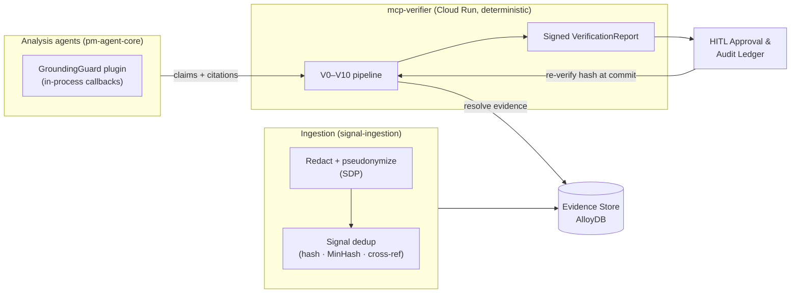

# 06 — Grounding / Verifier Layer (Evidence & Policy Gate)

> **Mandate (R6, GOV2, GOV4, GOV7, NFR-4, AC8).** Nothing factual reaches a PM screen, a proposed action, or a system of record unless it carries resolvable citations that the Verifier has **mechanically** checked. PII and secrets are redacted before any model sees them. Duplicates are caught before drafts are created. The gate **fails closed**.

---

## 1. Position in the architecture

The layer is implemented **three times, deliberately** (defense in depth):

| Enforcement unit | Where | What it guarantees | Can an LLM bypass it? |
|---|---|---|---|
| **Ingestion redaction & dedup** | `signal-ingestion` workflow → `mcp-verifier.redact` | Models only ever see redacted text; exact/near duplicates collapse before correlation | No — runs before storage; there is no unredacted read path for agents |
| **`GroundingGuard` ADK plugin** | Registered on every ADK `App` (global callbacks) | Tool allow-list per agent; tool outputs wrapped as *data*; user-facing text is claim-structured and fast-verified | No — callbacks run in framework code, outside the model loop |
| **`mcp-verifier` service** | Separate Cloud Run service, own identity, **zero write access to anything except its report table** | Full V0–V10 checks; KMS-signed `VerificationReport`; re-check at approval and at commit | No — the HITL Ledger refuses to propose/mint tokens without a PASS report whose `subject_sha256` matches the payload |

---

## 2. The grounding contract (recap of [10 §2.3](10-data-model-and-storage.md#23-citation-and-claim--the-grounding-contract-r6))

* Agents emit **structured output only** (Pydantic `output_schema` on every drafting `LlmAgent`): fields are lists of atomic `Claim`s, each with `Citation{evidence_id, span, quote, quote_sha256, permalink}`.
* Free-form prose is *rendered from verified claims* (PRD, KB article, chat answer) — never authored and then "checked".
* A PM answer is evidence: it is stored as a `pm_input` Signal (author = authenticated PM, permalink = ledger entry) and cited as `kind=pm_judgment`.
* `inference` claims are allowed only in `inferred_fields`, visibly flagged, and **cannot be committed** until the PM converts them into `pm_judgment`.

---

## 3. Verification pipeline (V0–V10)

Every check is a pure function of `(subject, evidence store snapshot, config versions)`. Checks V0–V4, V6–V10 are deterministic code. V5 is the only model-assisted check and is bounded (see §4).

| ID | Check | Mechanism (deterministic unless stated) | Failure ⇒ |
|---|---|---|---|
| **V0** | Schema | JSON-Schema validation of the subject against its template version (`slb-ado-requirement-v1`, `PrototypeSpec`, …). Unknown fields rejected. | FAIL |
| **V1** | Citation presence | Every claim with `kind ∈ {fact, classification, aggregate, pm_judgment}` has ≥ 1 citation. Every populated field consists only of claims. Every `procedural` sentence contains **zero atoms** (§3.1). | Claim **blocked** → field becomes `missing` → clarifying question generated (§13 of requirements) |
| **V2** | Resolvability | `evidence_id` exists in `evidence.chunks`, chunk status `active`, parent Signal `active` and not `tombstoned`; `permalink` equals the Signal's stored permalink and matches the source URL pattern; Signal `provenance_hash` re-computes. Memory-Bank or model-generated ids are rejected (DM-6). | Claim blocked |
| **V3** | Span fidelity | `chunk.text[span.start:span.end] == quote` (exact, after NFC) and `sha256(quote) == quote_sha256`. | Claim blocked |
| **V4** | Atom consistency | Every atom in `claim.text` (numbers, dates, versions, record ids, customer/product/component names from gazetteers, capitalized proper nouns) appears in ≥ 1 cited quote after normalization (case-fold, NFKC, thousands separators, unit aliases). | Claim blocked |
| **V5** | Entailment (bounded LLM judge) | §4. Judge sees **only** the claim text and its cited quotes. Must return `entailed`. | Claim blocked |
| **V6** | Aggregate recomputation | For `kind=aggregate`, recompute the value from linked evidence in SQL and compare exactly; each counted item must be cited. | FAIL (never "fixed" silently) |
| **V7** | Inference segregation | No `inference` claim outside `inferred_fields`; subjects bound for commit contain zero unresolved inference. | FAIL for commit-bound subjects |
| **V8** | Redaction | SDP `inspect` over the rendered subject (all text the target system will receive): zero `SECURITY_DATA` findings; zero raw PII per target policy (§5). | Auto-redact → re-run V3/V4 → else FAIL |
| **V9** | Policy | Policy-as-code rules (§7) for the target: audience confidentiality, legal tags, prohibited actions (GOV5), deny-by-default action catalog, DLS-reference validity for `PrototypeSpec` (every `component_key` exists in the pinned DLS catalog snapshot; every non-DLS node has a justification — FR-B3). | FAIL |
| **V10** | Near-duplicate gate (G3, FR-A4) | Similarity search of the subject against existing ADO work items, KB articles and problems (§6.3). | `NEEDS_PM_DECISION` (link / merge / proceed-with-reason); "proceed" is itself recorded as `pm_judgment` |

`overall = PASS` only if every claim in a commit-bound subject passed V1–V5, and V0, V6–V9 passed and V10 is resolved. The report is canonical-JSON hashed and signed with the `verifier-report-signer` KMS key.

### 3.1 Atom extraction (V1, V4)

Versioned, deterministic extractors (unit-tested against the SLB corpus):

| Atom class | Examples from the corpus | Detector |
|---|---|---|
| Record ids | `2830205`, `PD #11107122`, `CS2461006`, `INC…` | regex set `config.atom_patterns` |
| Versions / builds | `RD 25.10.1`, `WITSML Server 37.8.87` | version regex |
| Domain identifiers | `ETE-2172(h)`, `GW-198`, `TVDHD`, `GR_ROS`, `TIME_SURFACE` | uppercase/mixed-token regex + gazetteer |
| Quantities & dates | `-999.25`, `16` (array count), `9 May 2026` | number/date parsers with normalization |
| Organizations / products | `CVX`, `Chevron`, `ADNOC`, `ONGC`, `DrillOps`, `Lumi for Operations` | `config.gazetteers` (aliases map `CVX↔Chevron`) |

---

## 4. V5 — the bounded entailment judge

Mechanical checks prove a quote *exists* and *contains the atoms*; they cannot prove it *supports* the statement. V5 closes that gap under strict bounds:

| Property | Setting |
|---|---|
| Model | `gemini-3.8-flash` via `google-genai` (`enterprise=True`), version pinned in `config.models` (ADR-008) |
| Inputs | `claim.text` + cited `quote`s only; quotes wrapped in a data envelope; no tools, no history, no retrieval |
| Output | Structured: `{claim_id, verdict: entailed | not_entailed | insufficient, supporting_quote_index}` |
| Decoding | `temperature=0`, low thinking budget, `response_schema` enforced |
| Decision rule | Pass **iff** `verdict == entailed` **and** `supporting_quote_index` points to a cited quote |
| High-risk targets | `ADO_CREATE_WORK_ITEM`, `KB_PUBLISH_ARTICLE`: two independent judge prompts must both return `entailed` |
| Failure / timeout / quota | **Fail closed** — the claim is blocked; the PM sees "verification unavailable — not shown" (NFR-8) |
| Calibration | Judge precision/recall measured nightly on the labelled entailment set (E3, [13](13-testing-and-evaluation.md)); release gate ≥ 0.98 precision on `entailed` |

The judge can only *remove* claims; it can never add, rewrite, or "fix" content.

---

## 5. Redaction (PII & secrets)

### 5.1 Two layers

1. **Sensitive Data Protection (SDP)** `content.deidentify` at ingestion (before storage/embedding) and `content.inspect` at V8 (before anything leaves the perimeter).
2. **Model Armor** templates on the Agent Gateway (prompt + tool-response screening for prompt injection, jailbreak, sensitive data, malicious URLs) and, where an agent calls Gemini directly, `GenerateContentConfig.model_armor_config` (Agent-Platform-only field, verified in `google-genai`).

### 5.2 Detectors

| Category | SDP infoTypes (verified in SDP infoType reference) | Transformation | Reversible? |
|---|---|---|---|
| **Secrets** | `SECURITY_DATA` group: `AUTH_TOKEN, AWS_CREDENTIALS, AZURE_AUTH_TOKEN, BASIC_AUTH_HEADER, ENCRYPTION_KEY, GCP_API_KEY, GCP_CREDENTIALS, GEMINI_API_KEY, HTTP_COOKIE, JSON_WEB_TOKEN, OAUTH_CLIENT_SECRET, OPENAI_API_KEY, PASSWORD, SSL_CERTIFICATE, STORAGE_SIGNED_POLICY_DOCUMENT, STORAGE_SIGNED_URL, TINK_KEYSET, WEAK_PASSWORD_HASH, XSRF_TOKEN` | Replace with `[REDACTED:<INFO_TYPE>]`; flag HIGH (§13) | **Never** |
| **Custom secrets** (no built-in infoType) | Azure DevOps / GitHub PATs, SAS tokens (`sig=`), connection strings (`Server=…;Password=…`, `AccountKey=`), PEM private keys, WITSML server credentials in URLs | Custom regex infoTypes (`config.custom_infotypes`), same replacement | **Never** |
| **Personal data** | `PERSON_NAME, EMAIL_ADDRESS, PHONE_NUMBER, STREET_ADDRESS, IP_ADDRESS` (+ locale-specific as configured) | Deterministic pseudonymization (`cryptoDeterministicConfig`, KMS-wrapped key) → surrogate tokens such as `PERSON_9F2C1A` | Only via the re-identification service, for authorized PM UI display |
| **Customer business identity** | Customer names (CVX/Chevron, ONGC, ADNOC…) | **Not** PII; kept for impact analysis; governed by audience policy (§7) | n/a |

Determinism matters: the same engineer always maps to the same token, so "who resolved this before?" (FR-C2) still works without exposing identities to the model.

### 5.3 Where redaction runs

| Point | Action |
|---|---|
| Connector MCP server response (before return) | Server-side SDP de-identification; agents never receive raw text |
| `pm_input` (PM answers, uploads) | Same pipeline as connectors |
| Rendered subject at V8 | `inspect` — must be clean for the target audience |
| Logs/traces | Structured logging of ids & hashes only; prompt/response logging stays inside the perimeter with SDP applied (NFR-3) |

---

## 6. De-duplication (three levels)

| Level | Goal | Method | Default threshold (tuned by E1) |
|---|---|---|---|
| **6.1 Signal** | Same record ingested twice / mirrored across systems | (a) `provenance_hash` exact; (b) `CrossRef` hard links (e.g. SNOW note containing ADO URL `…/edit/2830205`); (c) MinHash over 5-word shingles | Jaccard ≥ 0.85 ⇒ duplicate-of |
| **6.2 Problem** | Many signals → one Product Problem (FR-A2, FR-C1) | `correlation-engine`: hybrid candidate retrieval (vector + lexical + metadata: product, customer, component, 90-day window) → score → LLM adjudicator for the grey zone (cited rationale) → periodic HDBSCAN re-clustering proposes merges/splits | assign ≥ 0.82 · grey 0.65–0.82 ⇒ adjudicate · < 0.65 new problem |
| **6.3 Draft** | Don't create a requirement/KB article that already exists (G3) | V10: semantic + title similarity vs. ADO (WIQL + `mcp-ado.search_work_items`), KB (`mcp-kb.search_articles`), problems store | ≥ 0.88 ⇒ `NEEDS_PM_DECISION` |

Merges of problems and links to existing work items are shown to the PM with the evidence for both sides; low-confidence merges require PM confirmation (requirements §13).

---

## 7. Policy engine (policy-as-code)

Rules live in `config.policies` (versioned YAML, CI-validated, change-logged to the ledger). Evaluated deterministically in `mcp-verifier` (V9) and mirrored in Agent Gateway Semantic Governance where expressible (Preview — [08](08-security-identity-and-governance.md)).

| Policy | Rule (summary) | Source |
|---|---|---|
| P-01 Deny-by-default actions | `action_type` ∉ catalog ⇒ deny + `POLICY_DENIED` ledger entry | Req §11 |
| P-02 Prohibited actions | purchases/payments, account creation, ToS acceptance, external communication ⇒ always deny | GOV5 |
| P-03 Outreach scope | `OUTREACH_SEND_INTERNAL` recipients must be in SLB tenant domains; no external addresses | GOV5 |
| P-04 Audience confidentiality | `KnowledgeArticleDraft.audience = global` ⇒ no customer names/well names unless PM marks `customer_cleared`; `regional` ⇒ only same-region customers | NFR-11 |
| P-05 Legal tags | Evidence carrying WODF legal tags / Purview labels above threshold may not be quoted into targets outside its allowed audience | NFR-11 |
| P-06 Advisory fields | `architecture_definition`, `engineering_acceptance_criteria`, `feasibility` must carry `advisory=true` and cannot be phrased as decisions | GOV3 |
| P-07 DLS reuse | `PrototypeSpec.reuse_ratio ≥ config.min_reuse_ratio`; every non-DLS node justified | FR-B2/B3 |
| P-08 Approval freshness | Proposals expire (default 72 h); commit requires report age < 24 h or re-verification | GOV1 |

---

## 8. Prompt-injection & content-as-data (GOV7)

| Layer | Control |
|---|---|
| Connector servers | Return content as typed JSON fields, never as instructions; strip HTML/script; flag instruction-like patterns (`ignore previous`, role prompts, tool-call syntax) → `contains_instructions=true` |
| Agent Gateway | Model Armor prompt-injection & jailbreak filter on tool responses (egress) and on PM prompts (ingress) — *Inspect and block* in prod |
| `GroundingGuard.after_tool` | Wraps every tool result in a data envelope (`<evidence id=… source=…>…</evidence>`); records a "disregarded embedded instructions" note when flagged (requirements §13) |
| Agent design | Analysis agents hold **no write tools** (ADR-003); even a successful injection cannot mutate a system of record |
| V5 judge | Sees only claim + quotes, no tools — injection in a quote cannot trigger actions |

---

## 9. Failure behaviour (fail-closed)

| Condition | Behaviour |
|---|---|
| Verifier unavailable | Drafts stay `pending`; no proposals; chat answers show only procedural text + "evidence verification unavailable" |
| SDP unavailable | Ingestion pauses for that source (queue retained); nothing un-redacted is stored |
| Judge quota exhausted | V5 fails closed for affected claims; alert raised |
| Evidence tombstoned after approval | Commit re-verification fails ⇒ action returns to `CHANGES_REQUESTED` |
| Policy config invalid | Previous valid version stays active; CI blocks the change |

---

## 10. Interfaces (`mcp-verifier` tools)

| Tool | Callers (identity) | Annotations |
|---|---|---|
| `verifier.redact(text, source_system, audience)` | ingestion, connector servers, pm-workbench (PM input) | readOnly (no external side effects) |
| `verifier.check_claims(claims[], mode: fast|full)` | GroundingGuard (chat answers: V1–V5) | readOnly |
| `verifier.verify_subject(subject_ref)` → `VerificationReport` | drafting nodes, HITL Ledger, commit-executor | stores report (internal) |
| `verifier.near_duplicates(subject_ref, targets[])` | requirement/knowledge agents, V10 | readOnly |
| `verifier.policy_evaluate(action_type, payload, target)` | HITL Ledger (at propose & mint) | readOnly |

## 11. Metrics (exported to Cloud Monitoring; KPI "Grounding integrity" = 100 %)

`claims_total`, `claims_blocked_by_check{V1..V10}`, `uncited_claims_in_approved_outputs` (**must be 0**), `judge_latency_ms`, `redaction_findings{infoType}`, `near_dup_decisions{linked|merged|proceeded}`, `verification_unavailable_minutes`.
