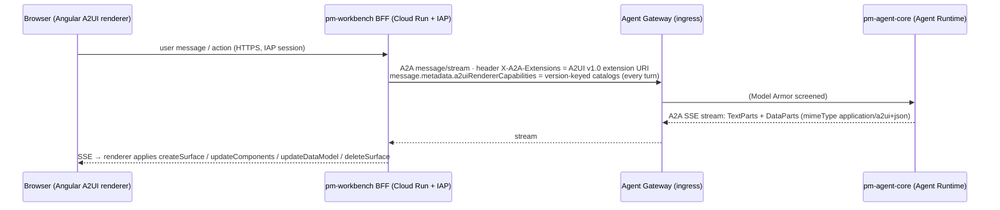

# 11 — A2UI PM Workbench (Experience Layer)

> The PM's single pane: problems, evidence, drafts, approvals, prototypes, traceability and audit — rendered with **A2UI v1.0** from agent output, with decisions that are cryptographically the PM's own. Re-verified 2026-11-24 against the A2UI repository (`github.com/a2ui-project/a2ui`, `specification/v1_0/`) and the installed `a2ui-agent-sdk` 0.12.1 / `a2ui-adk` 0.3.0 / `a2ui-a2a` 0.4.0 ([02 §4](02-platform-verification-log.md#4-re-verification-2026-11-24-after-g2-approval)).

---

## 1. Version & package decisions (ADR-007, accepted)

| Item | Decision | Verified basis |
|---|---|---|
| Protocol | **A2UI v1.0** (spec status "Current"; GA 2026-11-11). v0.9.1 is superseded; no migration debt because no v0.9 code was written | v1.0 spec header; repo README |
| Agent SDKs | `a2ui-agent-sdk==0.12.1` (pulls `a2ui-core` 0.7.x) · `a2ui-adk[a2a]==0.3.0` (ADK integration) · `a2ui-a2a==0.4.0` (A2A integration) — exact pins (pre-1.0 packages) | PyPI; installed-package introspection |
| A2A SDK | `a2a-sdk==0.3.26` — `a2ui-a2a` requires `>=0.3.0,<0.4.0`; ADK 2.15 accepts it | package metadata |
| Renderer | **Angular** (`@a2ui/angular`); React (`@a2ui/react`) and Lit (`@a2ui/lit`) are equivalent alternatives — all published for v1.0 | repo README packages table |
| Isolation | All A2UI usage goes through `pm_agent.a2ui` (our adapter) so SDK churn touches one module; contract tests pin the wire format | design rule |

---

## 2. Transport



* Extension URI: `https://a2ui.org/a2a-extension/a2ui/v1.0` (activation via `X-A2A-Extensions` is optional; capabilities are what count).
* A2UI messages travel in A2A `DataPart`s with `metadata.mimeType = "application/a2ui+json"` (`a2ui.a2a.create_a2ui_parts(messages, version="1.0")`).
* The BFF attaches `message.metadata["a2uiRendererCapabilities"] = {"1.0": {"supportedCatalogIds": [SLB, BASIC]}}` to **every** message; per spec the agent **must not** send A2UI on a turn without it (it falls back to text).
* A2UI surfaces map to the A2A `contextId` (one PM session ⇒ one context).
* This realizes the workspace's "reactive streaming controller (SSE)" pattern with standard A2A streaming instead of custom `onUiComponentDelivery` frames (not part of A2UI).

---

## 3. Who generates the UI (key design choice)

| Surface class | Generated by | Why |
|---|---|---|
| **Decision surfaces** (ApprovalCard, FieldDiff, VerifierBadge, duplicate decision, clarifying-question form) | **Deterministic surface builders** in `pm_agent.a2ui.surfaces` (pure functions over verified objects) | The PM must approve *exactly* what was verified (H-4); an LLM must not lay out, omit or re-word decision content |
| Status/progress surfaces | Deterministic builders | Predictable UX, no model cost |
| Exploratory answers (Q&A summaries, trend briefs) | LLM via `a2ui.adk.SendA2uiToClientToolset` + `A2uiInstruction`, constrained to the SLB catalog; payload validated before send; claims inside must already be verified | Flexible layouts where no decision is taken |

Surface ownership across sub-agents: only the agent that created a surface may update it, and the data model of surfaces owned by other agents is stripped before forwarding (multi-agent security rule carried over from the A2UI guidance).

---

## 4. Catalogs

* **Basic catalog** (v1.0): `catalogId = "https://a2ui.org/specification/v1_0/catalogs/basic/catalog.json"` (read from `BasicCatalog("1.0").catalog_id`, never hard-coded elsewhere). Components: `Text, Image, Icon, Video, AudioPlayer, Row, Column, List, Card, Tabs, Divider, Modal, Button, CheckBox, TextField, DateTimeInput, ChoicePicker, Slider` + basic functions (`required`, `regex`, `email`, `formatDate`, `openUrl`, …). No `Table`/`Heading` in the basic catalog.
* **SLB custom catalog** `catalogId = "slb.com:pm_workbench_v1"` (v1.0 recommends a domain-prefixed id; additive-only versioning; major version in the id). **v1.0 allows mixing catalogs per component via `@catalogId`**, so decision surfaces use the basic catalog for layout and the SLB catalog only for domain components:

| Component | Purpose | Key props (data-bound with `{"@path": …}`) |
|---|---|---|
| `CitationChip` | Inline citation → opens evidence | `evidenceId`, `sourceSystem`, `recordId`, `permalink` |
| `EvidencePanel` | Source excerpt with highlighted span, provenance, re-identification on demand | `quote`, `span`, `signal`, `revealAllowed` |
| `ClaimList` | Renders a `DraftField` (claims + chips; inferred claims visually distinct) | `claims`, `fieldStatus` |
| `VerifierBadge` | V0–V10 status, blocked-claim count, report link | `report` |
| `ApprovalCard` | Action summary, target, risk flags | `action`, `report`, `diff` |
| `FieldDiff` | Draft vs. existing ADO/KB object or previous version | `before`, `after` |
| `ReadinessChecklist` | Six FR-A5 items with status + linked questions | `items` |
| `DataTable` | Tabular data (ticket lists, aggregates) | `columns`, `rows` |
| `Timeline` | Investigation / ledger timelines | `events` |
| `TraceGraph` | Customer → … → Roadmap chain (AC7) | `nodes`, `links` |
| `PrototypePreview` | Screens from Figma render with component-reuse overlay | `images`, `reuse` |
| `SourceHealth` | Partial-data banner per connector (IR3) | `sources` |

The catalog schema lives at `src/pm_agent/a2ui/catalogs/slb_pm_workbench_v1.json` (JSON Schema, `$id == catalogId`). Each component needs an Angular implementation styled with SLB DLS tokens — **placeholder** until the DLS token set is supplied (Q-03).

Component and surface ids must follow UAX #31 identifier rules (`approve_act_01j9` ✅, `approve-act-01j9` ❌); builders sanitize ids.

---

## 5. Surfaces

| Surface | Requirements | Main components | Actions (event names) |
|---|---|---|---|
| **Problem Inbox** | FR-C8, O1 | `DataTable`, `SourceHealth` | `open_problem`, `filter` |
| **Problem Detail** | FR-A2/A3, FR-C1 | `ClaimList` (title, classification, impact), `DataTable` (linked signals), `CitationChip`, `EvidencePanel` | `confirm_merge`, `split_signal`, `start_requirement`, `investigate` |
| **Readiness & Questions** | FR-A5/A6, AC2 | `ReadinessChecklist`, `TextField`, `ChoicePicker` | `answer_questions` (→ `pm_input` signals), `draft_outreach` |
| **Requirement Review & Approval** | FR-A7/A8/A10, AC3 | `ClaimList` per field, `VerifierBadge`, `FieldDiff`, `ApprovalCard` | `approve_action`, `request_changes`, `reject_action`, `edit_field` |
| **Prototype Plan & Validation** | FR-B1–B5, AC4 | `ClaimList` (brief), `DataTable` (component mapping + justifications), `PrototypePreview`, `ApprovalCard` | `approve_action` (render / release), `request_changes` |
| **Investigation Pack** | FR-C1–C3, C5, AC5 | `Timeline`, `DataTable` (related + prior resolutions), `ClaimList` (engagements) | `confirm_outcome`, `draft_kb`, `draft_bug` |
| **Knowledge Draft Review** | FR-C4, AC6 | `ClaimList` (symptom/cause/resolution), `VerifierBadge`, `ApprovalCard` | `approve_action`, `request_changes` |
| **Traceability Explorer** | FR-C6/C7, AC7 | `TraceGraph`, `DataTable` | `confirm_link`, `record_roadmap_decision` (PM act) |
| **Audit Ledger** | GOV6, AC10 | `Timeline`, `DataTable` | `filter`, `export` |

---

## 6. Action handling

| Action class | Path | Rules |
|---|---|---|
| Ordinary actions | Browser → BFF → A2A → agent (A2UI v1.0 `action{name, surfaceId, sourceComponentId, timestamp, context, userMessage?}`) | Agent re-validates context; client `@checks` are UX only |
| **Decision actions** (`approve_action`, `reject_action`, `request_changes`) | Browser → BFF → **`mcp-ledger.decide`** with forwarded IAP JWT → BFF then resumes the paused workflow by answering the `adk_request_input` call with `{action_id, decision}` (resume contract verified, [02 §4.3](02-platform-verification-log.md#43-items-resolved)) | Never routed through an LLM; ledger verifies identity, group, freshness, hash; the agent re-reads ledger state before continuing (H-2) |
| Reveal (re-identify a pseudonym) | BFF → `mcp-store.reveal` | Authorized groups only; ledger-logged |

Example decision surface (A2UI v1.0, abbreviated — generated by `pm_agent.a2ui.surfaces.approval_surface`):

```json
[
 {"version": "1.0", "createSurface": {
   "surfaceId": "approve_act_01j9",
   "catalogId": "https://a2ui.org/specification/v1_0/catalogs/basic/catalog.json",
   "sendDataModel": false,
   "components": [
     {"id": "root", "component": "Column", "children": ["card", "approve_btn"]},
     {"id": "card", "component": "ApprovalCard", "@catalogId": "slb.com:pm_workbench_v1",
      "action": {"@path": "/action"}, "report": {"@path": "/report"}, "diff": {"@path": "/diff"}},
     {"id": "approve_lbl", "component": "Text", "text": "Approve & create ADO Requirement"},
     {"id": "approve_btn", "component": "Button", "variant": "primary", "child": "approve_lbl",
      "action": {"event": {"name": "approve_action",
                           "context": {"actionId": {"@path": "/action/action_id"},
                                       "comment": {"@path": "/review/comment"}}}}}
   ],
   "dataModel": {"action": {"action_id": "act_01j9", "action_type": "ADO_CREATE_WORK_ITEM"},
                 "report": {"overall": "PASS"}, "diff": {}, "review": {"comment": ""}}
 }}
]
```

---

## 7. UX principles

1. **Every factual sentence has a chip**; clicking shows the exact quote with its permalink.
2. **Inferred ≠ fact**: inferred claims render with a distinct style and "needs your confirmation" affordance.
3. **Partial data is loud**: `SourceHealth` banner whenever a connector was unavailable.
4. **No silent writes**: every external effect is preceded by an `ApprovalCard` showing target, payload diff and verifier status.
5. **Explain the gate**: blocked claims are listed ("removed — no supporting evidence") with the clarifying question that replaces them.
6. Accessibility: keyboard-first navigation, WCAG 2.1 AA contrast via SLB DLS tokens, `@accessibility` attributes on all components.

---

## 8. Known issues to manage

| Issue | Handling |
|---|---|
| A2UI SDK packages are pre-1.0 and release weekly | Exact pins; all usage behind `pm_agent.a2ui`; contract tests validate emitted messages against the v1.0 JSON schemas |
| `a2ui-a2a` still requires `a2a-sdk` 0.3.x while A2A 1.x exists | Pin 0.3.26; revisit when `a2ui-a2a` supports A2A 1.x (tracked in RK-02) |
| ADK's A2UI docs page lags the SDK | Follow the A2UI repo + SDK changelogs |
| SLB DLS tokens / custom fonts unknown | Renderer theme and catalog component styling are **placeholders** (Q-03) |
